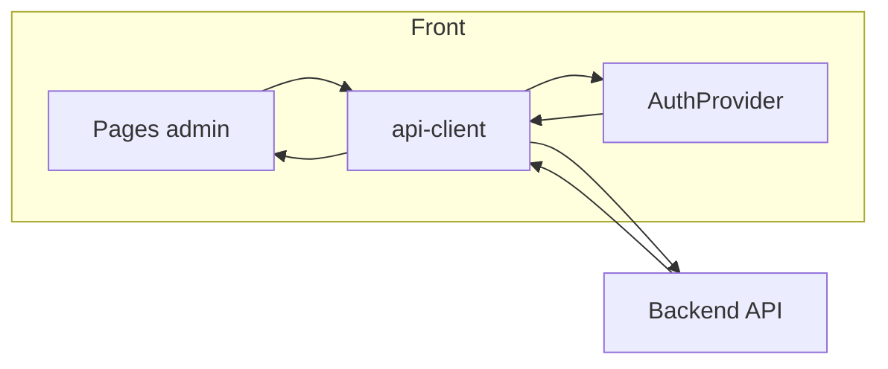
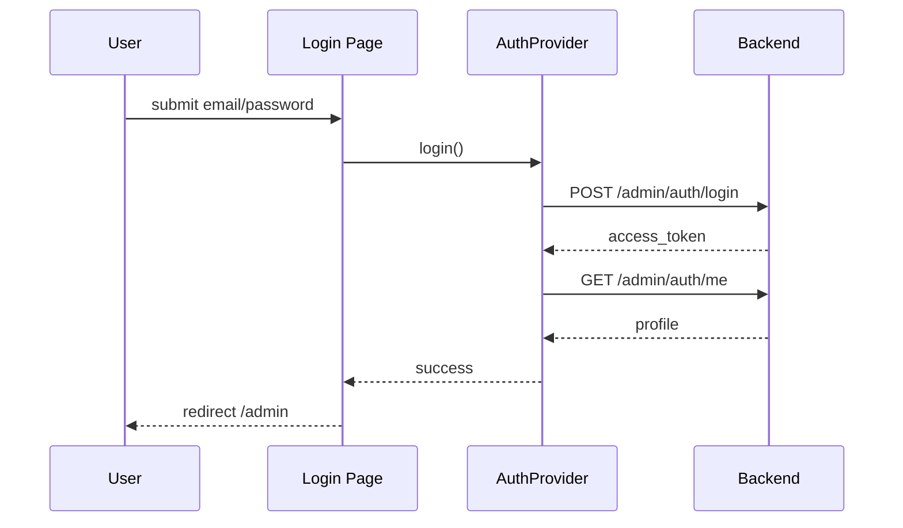

# Integration back/front (admin)

## Objectif

Documenter le branchement entre le front admin et le backend, avec un schema visuel et un tableau des endpoints relies. Ce document doit etre mis a jour a chaque nouveau branchement.

## Vue d'ensemble (flow)

## Sequence login admin

## Branchements actifs (a maintenir)

| Module       | Front              | Endpoint                         | Statut |
| ------------ | ------------------ | -------------------------------- | ------ |
| Admin auth   | AuthProvider       | POST /admin/auth/login           | lie    |
| Admin auth   | AuthProvider       | GET /admin/auth/me               | lie    |
| Admin auth   | AuthProvider       | POST /admin/auth/logout          | lie    |
| Admin events | Admin events UI    | GET /admin/events/               | lie    |
| Admin events | Admin events UI    | POST /admin/events/              | lie    |
| Admin events | Admin events UI    | POST /admin/events/{id}/schedule | lie    |
| Admin events | Admin events UI    | POST /admin/events/{id}/archive  | lie    |
| Admin events | Admin events UI    | POST /admin/events/{id}/draft    | lie    |
| Admin users  | Admin users UI     | GET /admin/users/                | lie    |
| Admin users  | Admin users UI     | POST /admin/users/               | lie    |
| Admin users  | Admin users UI     | GET /admin/users/{id}            | lie    |
| Admin users  | Admin users UI     | PUT /admin/users/{id}            | lie    |
| Admin users  | Admin users UI     | DELETE /admin/users/{id}         | lie    |
| Admin users  | Admin users UI     | POST /admin/users/{id}/block     | lie    |
| Admin users  | Admin users UI     | POST /admin/users/{id}/unblock   | lie    |
| Admin audits | Logs -> Audits tab | GET /admin/audits                | lie    |

## Regles de mise a jour

- Ajouter une ligne pour chaque nouvel endpoint branche.
- Supprimer les lignes si un endpoint est retire.
- Garder le schema a jour si l'architecture change.
