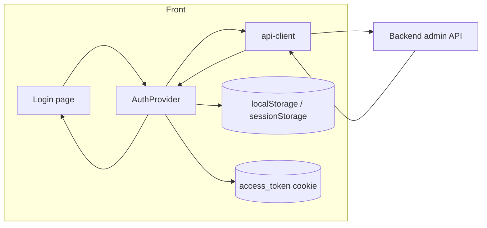
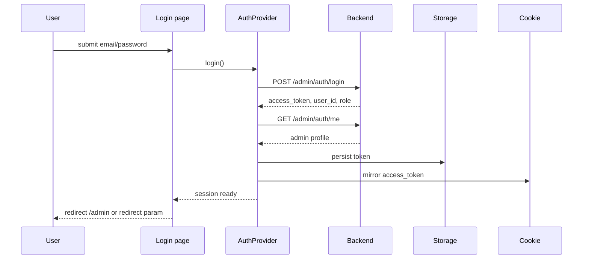
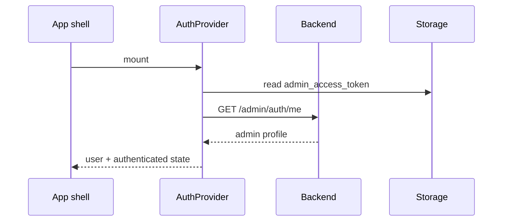
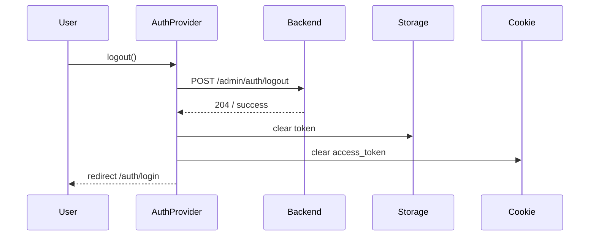

# Integration front/back - auth admin

## Scope courant

L'image Docker et le backend actuellement connectes au front ne couvrent pour le moment que le flux d'auth admin suivant:

- login avec email et mot de passe
- restauration de session au chargement
- logout

Les fonctionnalites suivantes ne sont pas encore branchees dans cette version:

- inscription
- reset de mot de passe
- auth Discord

## Vue d'ensemble

La page admin `Users` centralise maintenant deux vues:

- `Users` pour les end users
- `Staff users` pour les comptes internes

Les endpoints backend restent separes, mais l'interface front les expose dans une seule page avec un toggle.

La route `/admin/staff-users` reste disponible comme alias technique et redirige vers `Users` avec la vue staff.

## Auth flow

### 1. Login

### 2. Session restore

### 3. Logout

## Auth state rules

- `admin_access_token` is the client token key used by the app.
- `remember me` stores the token in `localStorage`.
- otherwise the token is stored in `sessionStorage`.
- `api-client` automatically adds `Authorization: Bearer <token>` when a token key is provided.
- `AuthProvider` also mirrors the token in an `access_token` cookie for backend compatibility.
- if `GET /admin/auth/me` returns `401`, the client clears the session and forces a new login.
- if login succeeds but session hydration fails, the client rolls back the session instead of keeping a half-open state.

## Endpoints branches

| Domaine     | Front           | Endpoint               | Statut | Notes |
| ----------- | --------------- | ---------------------- | ------ | ----- |
| Admin auth  | AuthProvider    | POST /admin/auth/login | lie    | Login et retour du token |
| Admin auth  | AuthProvider    | GET /admin/auth/me     | lie    | Hydratation de session |
| Admin auth  | AuthProvider    | POST /admin/auth/logout | lie   | Logout best-effort + cleanup client |
| Admin users | Users page - tab Users | GET /admin/users/      | lie    | Liste paginee des users |
| Admin users | Users page - tab Users | GET /admin/users/{id}  | lie    | Chargement d'un user par id |
| Admin users | Users page - tab Users | POST /admin/users/     | lie    | Creation d'un user |
| Admin users | Users page - tab Users | PUT /admin/users/{id}  | lie    | Mise a jour d'un user |
| Admin users | Users page - tab Users | DELETE /admin/users/{id} | lie  | Suppression d'un user |
| Admin users | Users page - tab Users | POST /admin/users/{id}/block | lie | Blocage d'un user |
| Admin users | Users page - tab Users | POST /admin/users/{id}/unblock | lie | Deblocage d'un user |
| Staff users | Users page - tab Staff users | GET /admin/staff-users/ | lie    | Liste des staff users |
| Staff users | Users page - tab Staff users | POST /admin/staff-users/ | lie    | Creation d'un staff user |
| Staff users | Users page - tab Staff users | PATCH /admin/staff-users/{staff_user_id} | lie | Mise a jour d'un staff user |
| Staff users | Users page - tab Staff users | DELETE /admin/staff-users/{staff_user_id} | lie | Suppression d'un staff user |

## Hors scope

Ces elements restent volontairment hors du front actuel:

- register
- password reset
- discord oauth
- public user auth

## Regles de mise a jour

- Ajouter une ligne pour chaque nouvel endpoint branche.
- Mettre a jour les diagrammes si le flow d'auth change.
- Garder cette page alignee avec le comportement reel du front.
